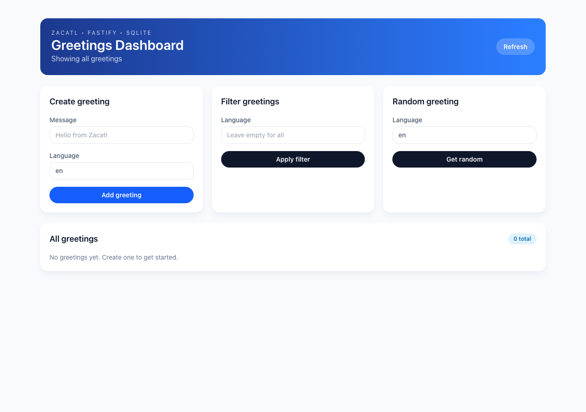

# Zacatl Framework

<div align="center">

**Package**

[](https://www.npmjs.com/package/@sentzunhat/zacatl)
[](https://www.npmjs.com/package/@sentzunhat/zacatl)
[](./LICENSE)

**Quality**

[](https://github.com/sentzunhat/zacatl/actions/workflows/ci.yml)
[](https://github.com/sentzunhat/zacatl/actions/workflows/cve-scan.yml)
[](https://github.com/sentzunhat/zacatl/actions/workflows/release.yml)
[](#-testing)
[](#-testing)

**Stack**

[](https://www.typescriptlang.org/)
[](https://nodejs.org/)

</div>

**Build consistent TypeScript services without giving up the frameworks you already use.**

Zacatl gives TypeScript teams a repeatable `Service` composition model:
`Service` coordinates sibling `Layers` (Application, Domain, Infrastructure)
and `Platforms` (Server, CLI, Desktop). The Infrastructure layer owns
database connections, ORM adapters, and repositories; Server owns HTTP, API
routes, and pages. You keep using [Fastify](https://fastify.dev),
[Express](https://expressjs.com), [Mongoose](https://mongoosejs.com), or
[Sequelize](https://sequelize.org); Zacatl supplies the boundaries that keep
those choices from leaking through the whole application.

It is aimed first at teams building modular APIs and backend services that want consistent project structure, replaceable adapters, and earlier feedback from tests and CI/CD.

## Table of Contents

- [Why Zacatl](#-why-zacatl)
- [See It in a Real Service](#-see-it-in-a-real-service)
- [Quick Start](#-quick-start)
- [ORM Adapters](#️-orm-adapters)
- [Architecture](#️-architecture)
- [Platform Support](#-platform-support)
- [Examples & Screenshots](#-examples--screenshots)
- [Public API Modules](#-public-api-modules)
- [Documentation](#-documentation)
- [Testing](#-testing)
- [Requirements](#-requirements)
- [Contributing](#-contributing)
- [License](#-license)
- [Acknowledgments](#-acknowledgments)

## ✨ Why Zacatl

Zacatl is useful when a service needs to stay understandable as it grows, or when several services need to follow the same architectural rules without sharing one large application.

- **Keep business logic portable:** domain services depend on repository ports, while database and platform adapters remain replaceable.
- **Make boundaries visible:** routes, validation, services, repositories, and startup wiring have clear homes and test seams.
- **Catch drift earlier:** typed contracts, focused tests, dependency checks, and CI-friendly verification make consistency part of the workflow.

| Capability                  | Detail                                                             |
| ---------------------------- | ------------------------------------------------------------------ |
| 🏗️ Service Architecture     | Service coordinates sibling Layers and Platforms modules           |
| 💉 Dependency Injection     | Built-in DI container via `tsyringe`                                |
| ✅ Type-Safe Validation     | Zod schema support; Yup and optional validation planned            |
| 🛡️ Structured Errors        | 8 custom error types with correlation IDs                          |
| 🗄️ Pluggable ORM Adapters   | Sequelize, Mongoose, built-in SQLite via `node:sqlite`, or custom   |
| 🌐 Server Framework Choice  | Fastify or Express — same domain logic, swap the adapter           |
| 🌍 Internationalization     | Pluggable i18n with filesystem/memory adapters                     |
| 📝 Production Observability | Structured logging and error tracking                              |
| 🧪 Tested                   | Vitest suite — counts and coverage in the badges; see [Testing](#-testing) |

## 🧭 See It in a Real Service

The [`fastify-sqlite-react`](./examples/fastify-sqlite-react) example is a complete greeting CRUD service. One request travels through four files, each with a single job:

```text
POST /api/greetings
  → CreateGreetingHandler   (application: validate + map HTTP)
  → GreetingServiceAdapter  (domain: business rules)
  → GreetingRepositoryAdapter (infrastructure: persistence)
  → Sequelize / SQLite
```

**1. Route handler** — the Zod schema validates the request before your code runs; invalid input gets a 400 on both Fastify and Express.

```typescript
export const CreateGreetingBodySchema = z.object({
  message: z.string().min(1, 'Message is required'),
  language: z.string().min(2, 'Language code must be at least 2 characters'),
});

@singleton()
export class CreateGreetingHandler extends PostRouteHandler<CreateGreetingBody, void, GreetingResponse> {
  constructor(@inject(GreetingServiceAdapter) private readonly greetingService: GreetingServiceAdapter) {
    super({ url: '/greetings', schema: { body: CreateGreetingBodySchema } });
  }

  async handler(request: Request<CreateGreetingBody>): Promise<GreetingResponse> {
    const greeting = await this.greetingService.createGreeting(request.body);
    return toGreetingResponse(greeting);
  }
}
```

**2. Domain service** — business rules, no HTTP or database types. Throwing a Zacatl error maps to the right status code.

```typescript
@singleton()
export class GreetingServiceAdapter implements GreetingServicePort {
  constructor(@inject(GreetingRepositoryAdapter) private readonly greetingRepository: GreetingRepositoryAdapter) {}

  async createGreeting(input: CreateGreetingInput): Promise<Greeting> {
    if (input.message.trim().length === 0) {
      throw new BadRequestError({ message: 'Greeting message cannot be empty' });
    }
    return this.greetingRepository.create({ ...input, language: input.language.toLowerCase() });
  }
}
```

**3. Repository** — Zacatl's ORM-specific `BaseRepository` supplies create/read/update/delete; you add only the queries your domain needs. Import it from the matching Mongoose, Sequelize, or node:sqlite subpath.

```typescript
@singleton()
export class GreetingRepositoryAdapter
  extends BaseRepository<GreetingModel, CreateGreetingInput, Greeting>
  implements GreetingRepositoryPort
{
  constructor() {
    super({ name: GreetingModel.name });
  }
}
```

**4. Wiring** — list each layer's classes once; Zacatl registers them in the DI container and mounts the routes.

```typescript
layers: {
  infrastructure: { repositories: [GreetingRepositoryAdapter] },
  domain: { services: [GreetingServiceAdapter] },
  application: { entryPoints: { rest: { hooks: [], routes: [CreateGreetingHandler /* , … */] } } },
},
```

Run it:

```bash
cd examples/fastify-sqlite-react
docker compose up -d
curl http://localhost:8081/api/greetings
```

The same flow is implemented across Fastify/Express, SQLite/PostgreSQL/MongoDB, and React/Svelte in the [examples matrix](./examples/README.md). Swapping Fastify for Express or SQLite for MongoDB changes the adapter and wiring, not the domain service.

## 🚀 Quick Start

```bash
npm install @sentzunhat/zacatl
```

Database drivers are optional peers — install only the one you use (see [ORM Adapters](#️-orm-adapters)). A minimal service:

```typescript
import Fastify from 'fastify';
import { Service, ServiceType } from '@sentzunhat/zacatl/service';
import { ServerType, ServerVendor } from '@sentzunhat/zacatl/service/platforms/server/types/server-config';

const fastify = Fastify();

const service = new Service({
  type: ServiceType.SERVER,
  layers: {
    application: { entryPoints: { rest: { hooks: [], routes: [] } } },
    domain: { services: [] },
    infrastructure: { repositories: [] },
  },
  platforms: {
    server: {
      name: 'hello-service',
      server: { type: ServerType.SERVER, vendor: ServerVendor.FASTIFY, instance: fastify },
    },
  },
});

await service.start({ port: 3000 });
```

Add routes, services and repositories to `layers` as shown [above](#-see-it-in-a-real-service). See [examples/](./examples/) for eight runnable starters spanning Express/Fastify × SQLite/PostgreSQL/MongoDB × React/Svelte.

## 🗄️ ORM Adapters

Zacatl doesn't reimplement your database driver — it registers the real thing (Mongoose, Sequelize, or Node's built-in `node:sqlite`) on the service's `platforms.server.databases` list, and gives repositories a consistent shape regardless of which one you picked.

**Dependencies:** Zacatl installs its core server dependencies. Database libraries (`mongoose`, `mongodb`, `sequelize`, `sqlite3`, `pg`) are optional peers: install the ones your service uses. Non-SQL services never pull in Sequelize's dependency tree, and local-SQLite apps on Node 26 can use `node:sqlite` with no extra packages.

**Mongoose** (excerpt from [`examples/fastify-mongodb-react`](./examples/fastify-mongodb-react)):

```typescript
import mongoose from 'mongoose';
import { DatabaseVendor } from '@sentzunhat/zacatl/service/platforms/server/database/port';

const serviceConfig = {
  // ...
  platforms: {
    server: {
      // ...
      databases: [
        {
          vendor: DatabaseVendor.MONGOOSE,
          instance: mongoose,
          connection: { url: process.env.MONGO_URI ?? 'mongodb://localhost:27017/myapp' },
          indexes: { bootMode: 'create' }, // 'off' | 'create' | 'sync' — safe by default in prod
        },
      ],
    },
  },
};
```

**`node:sqlite`** — zero extra dependencies, no `sequelize` or `sqlite3` needed on Node 26+:

```typescript
import { DatabaseVendor } from '@sentzunhat/zacatl/service/platforms/server/database/port';

const databases = [{ vendor: DatabaseVendor.NODE_SQLITE, connection: { url: './data/app.db' } }];
```

**Sequelize** (Postgres, MySQL, SQLite via the traditional driver) follows the same `databases[]` shape with `DatabaseVendor.SEQUELIZE` — see [docs/third-party/README.md](./docs/third-party/README.md) for the full adapter matrix, and [docs/migration/sequelize-sqlite-to-nodesqlite.md](./docs/migration/sequelize-sqlite-to-nodesqlite.md) if you're moving a small app off Sequelize SQLite.

## 🏗️ Architecture

`Service` composes two sibling modules: `Layers` (Application, Domain and
Infrastructure) and `Platforms` (Server, CLI and Desktop). Infrastructure owns
database connections, ORM adapters and repositories; Server owns HTTP, API
routes and pages. Connection setup and its public config still live under
`platforms.server` pending a separately tracked move into Infrastructure.
Each nested module owns the ports and adapters for its contract.
See the [Service architecture map](./docs/service/architecture.md) for the
diagram, call flow, and implemented versus planned modules. Before `0.1.0`,
published `0.0.x` APIs may still change incompatibly; migration notes identify
known breaks.

## 🎯 Platform Support

| Platform      | Status              |
| ------------- | -------------------- |
| Server (HTTP) | Stable                |
| CLI           | Planned (stub only)   |
| Desktop       | Planned (stub only)   |

> For non-HTTP scripts and workers today, use the standalone DI helpers from `@sentzunhat/zacatl/dependency-injection` directly.

## 📸 Examples & Screenshots

Every example implements the same greeting CRUD flow behind a different framework/database/frontend combination, so you can compare them directly. Screenshots (and the walkthrough below) are captured automatically via Playwright against the real, dockerized app — not mockups.

**Fastify + MongoDB + React**, full create → update → delete cycle:


| Example                                                        | Server  | Database   | Frontend | Preview                                                                         |
| ---------------------------------------------------------------- | ------- | ---------- | -------- | -------------------------------------------------------------------------------- |
| [fastify-sqlite-react](./examples/fastify-sqlite-react)         | Fastify | SQLite     | React    |                  |
| [fastify-mongodb-react](./examples/fastify-mongodb-react)       | Fastify | MongoDB    | React    |                 |
| [fastify-postgres-react](./examples/fastify-postgres-react)     | Fastify | PostgreSQL | React    |                |
| [fastify-sqlite-svelte](./examples/fastify-sqlite-svelte)       | Fastify | SQLite     | Svelte   |                 |

The full gallery (all 8 examples × 4 states: initial, after-create, after-update, after-delete) lives in **[examples/README.md](./examples/README.md#screenshots)**.

### Run one locally with Docker

```bash
cd examples/fastify-sqlite-react
docker compose up -d
curl http://localhost:8081/api/greetings
```

Each example builds **one** Docker image containing both the compiled backend and the compiled frontend static files — there's no separate frontend container to wire up. MongoDB/PostgreSQL examples bring their own database sidecar via `docker compose`; SQLite examples need nothing extra. Full architecture, port table, and image-pinning guidance: **[examples/DOCKER.md](./examples/DOCKER.md)**.

## 📦 Public API Modules

| Module                 | Import path                                |
| ----------------------- | -------------------------------------------- |
| Service                | `@sentzunhat/zacatl/service`                |
| Configuration          | `@sentzunhat/zacatl/configuration`          |
| Dependency Injection   | `@sentzunhat/zacatl/dependency-injection`   |
| Errors                 | `@sentzunhat/zacatl/error`                  |
| Logs                   | `@sentzunhat/zacatl/logs`                   |
| Localization           | `@sentzunhat/zacatl/localization`           |
| Utils                  | `@sentzunhat/zacatl/utils`                  |
| Third-party re-exports | `@sentzunhat/zacatl/third-party/*`          |

## 📖 Documentation

Full docs live in **[`docs/`](./docs/README.md)**. New contributors start with **[docs/start-here.md](./docs/start-here.md)**.

| Topic                  | Link                                                                                                    |
| ------------------------ | ----------------------------------------------------------------------------------------------------- |
| Architecture Overview  | [docs/guidelines/framework-overview.md](./docs/guidelines/framework-overview.md)                        |
| Service Module         | [docs/service/README.md](./docs/service/README.md)                                                      |
| Dependency Injection   | [docs/dependency-injection/README.md](./docs/dependency-injection/README.md)                            |
| Configuration          | [docs/configuration/README.md](./docs/configuration/README.md)                                          |
| Errors                 | [docs/error/README.md](./docs/error/README.md)                                                          |
| Logs                   | [docs/logs/README.md](./docs/logs/README.md)                                                            |
| Localization           | [docs/localization/README.md](./docs/localization/README.md)                                            |
| Third-Party + ORM      | [docs/third-party/README.md](./docs/third-party/README.md)                                              |
| ESLint                 | [docs/eslint/README.md](./docs/eslint/README.md)                                                        |
| Utils                  | [docs/utils/README.md](./docs/utils/README.md)                                                          |
| CI/CD Pipeline         | [docs/guidelines/ci-cd-workflow.md](./docs/guidelines/ci-cd-workflow.md)                                 |
| Release Notes          | [docs/changelog.md](./docs/changelog.md)                                                                |
| Migration Guides       | [docs/migration/](./docs/migration/README.md)                                                           |

## 🧪 Testing

```bash
npm test                 # Run all tests
npm run test:coverage    # Coverage report
```

738 tests across 85 files passed locally for this development candidate. CI runs the full suite plus type-check, lint, and an 8-example Docker smoke matrix before any release — see [docs/guidelines/ci-cd-workflow.md](./docs/guidelines/ci-cd-workflow.md) for exactly what gates what.

> `CI` is the orchestrator — CVE scanning, peer-dependency install checks, the full test suite, and an 8-example Docker smoke matrix, gating every merge to `main`. `CVE scan` runs that same audit again on its own weekly schedule so its badge stays live independent of `CI`. `Release` reflects the actual tag → npm publish → GitHub Release pipeline, only fired by real releases. There's no separate "Publish dry-run" badge: that check only runs as part of `CI` (gated on a pending version bump), and giving it its own trigger would mean it either fails on ordinary non-release pushes or needs to duplicate that gate — not worth it for one more badge.

## 📋 Requirements

- **Node.js**: 26.0.0+
- **npm**: 11.0.0+
- **TypeScript**: 6.0+

## 🤝 Contributing

1. Open an issue describing the change.
2. Branch off it: `git checkout -b issue-<number>/type/description`
3. Add tests, update docs, commit with [Conventional Commits](https://www.conventionalcommits.org/).

See [CONTRIBUTING.md](./CONTRIBUTING.md) for the full guide.

## 📄 License

[Apache License 2.0](./LICENSE) © 2026 Zacatl Contributors

> Zacatl is permissively licensed. Please don't use it to harm people.

## 🤖 Acknowledgments

This framework was built with assistance from AI coding models and agents — including Claude (Anthropic), OpenAI models, GitHub Copilot, and open-source tooling like Cursor and Continue — alongside plenty of human review and decision-making. Zacatl's own design leans into that collaboration: its docs and structure are intentionally written to be navigable by both people and AI agents. Thank you to the teams building these tools.
