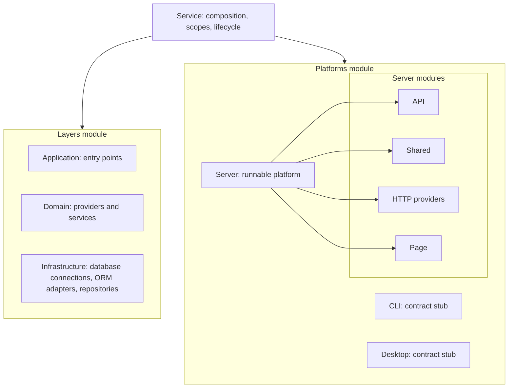

# Service architecture map

Zacatl's `Service` is the composition and lifecycle boundary. It manages two
**sibling modules**, `Layers` and `Platforms`. The three hexagonal layers live
*inside* `Layers`; `Platforms` is not a fourth member of that stack. Ports and
adapters belong to the module whose contract they implement, including nested
modules. This map describes ownership, not a requirement to add a directory or
interface for every box.

## Responsibilities and current source

| Boundary | Owns | Current source and status |
| --- | --- | --- |
| Service | Configuration, scoped composition, preparation and startup order | `src/service/service.ts`; implemented |
| Layers | Application, Domain and Infrastructure registration | `src/service/layers/layers.ts`; implemented |
| Application | Entry points that receive requests and invoke domain behavior | `src/service/layers/application/entry-points/rest/`; REST implemented |
| Domain | Business behavior exposed by providers and services, with ports for dependencies | `src/service/layers/domain/`; providers/services implemented; a distinct `clients/` module is a design direction, not a current directory or config field |
| Infrastructure | Database connections, ORM adapters, repositories and schemas/models | `src/service/layers/infrastructure/` owns ORM and repositories; connection lifecycle still lives in `src/service/platforms/server/database/` during the transition |
| Platforms | Runtime-specific hosts and adapters | `src/service/platforms/`; Server runs, CLI and Desktop are stubs |
| Server | HTTP listener, API routes, pages, shared utilities and HTTP providers | `src/service/platforms/server/`; currently also hosts database connection setup, tracked for relocation to Infrastructure |

The owner-described flow is: an Application entry point calls Domain behavior;
Domain uses ports implemented by Infrastructure; a repository uses its ORM
adapter and model/schema. Infrastructure owns database resources; Server owns
HTTP, routes and pages. A future Domain client may bridge entry points and providers, but
the current public `DomainConfig` exposes `providers` and `services`, not a
separate `clients` registration. The arrows express calls and dependency
contracts, not folder nesting. Keep domain business code independent of a
particular HTTP provider or database driver.

## Scope and lifecycle

`Service` creates a service container and an Infrastructure → Domain →
Application child-container chain. The Server platform receives the Application
scope for route resolution. `Service` prepares database and page resources,
makes repositories ready, then starts listening. Direct `Server.start()` also
prepares before listening. Service-owned ORM registrations and Mongoose index
policy are isolated in each Service's Infrastructure scope; direct/manual ORM
use retains the global fallback. The physical database connection files and
`platforms.server.databases` config remain transitional until the separately
tracked Infrastructure migration is designed and implemented.

For a consumer, the supported composition entry point is one `ServiceConfig`
passed to `new Service(config)`. New module types, Domain clients, and CLI or
Desktop implementations need their own design and verification before the
diagram can be read as an implemented API.
