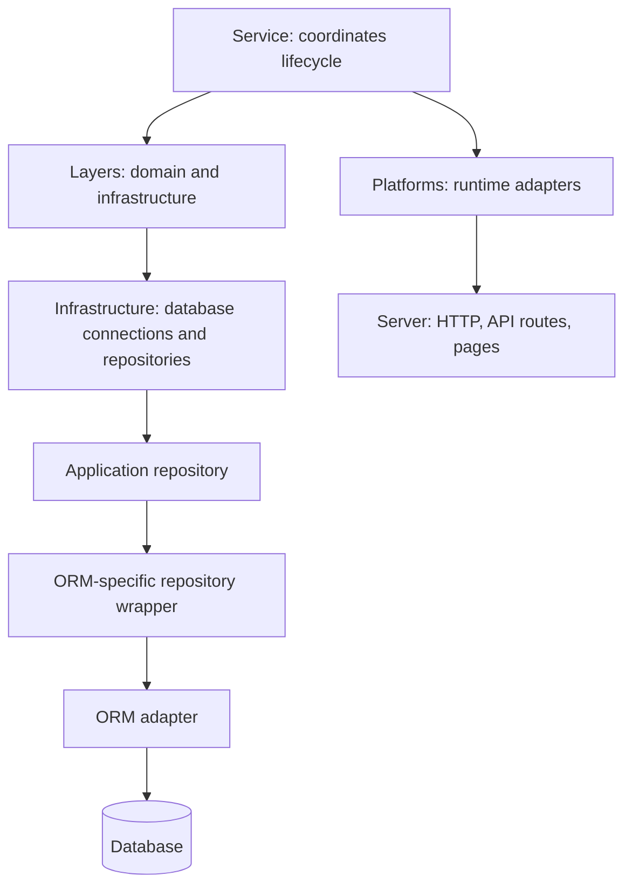

# ORM and Repository Architecture

Zacatl separates application-facing repository contracts from ORM-specific
infrastructure adapters. The Service coordinates startup and shutdown. Layers
owns persistence wiring, while Platforms (including Server) owns HTTP, routes,
and pages.



## Repository contracts and wrappers

`RepositoryPort` and `ORMPort` are type-only contracts defined at
`service/layers/infrastructure/repositories/types`. The shared implementation
at `repositories/base-repository` delegates CRUD operations to an `ORMPort`.
Application code should normally extend the ORM-specific wrapper, which builds
the matching adapter:

| Storage | Wrapper import | Generic parameters |
| --- | --- | --- |
| Mongoose | `service/layers/infrastructure/repositories/mongoose/repository` | database document, input, output |
| Sequelize | `service/layers/infrastructure/repositories/sequelize/repository` | model attributes, input, output |
| Node.js SQLite | `service/layers/infrastructure/repositories/nodesqlite/repository` | input, output |

Each wrapper exports a class named `BaseRepository`. Alias the import when a
file uses more than one database:

```typescript
import { BaseRepository as MongooseRepository } from '@sentzunhat/zacatl/service/layers/infrastructure/repositories/mongoose/repository';
import { BaseRepository as SequelizeRepository } from '@sentzunhat/zacatl/service/layers/infrastructure/repositories/sequelize/repository';
```

A repository targets one ORM. If a service uses two databases, define two
repository classes with the corresponding wrappers. Do not select a driver by
changing a runtime `ORMType` on one generic repository class.

## Startup ownership

Configure database instances through the Server platform's database
configuration. Layers' infrastructure resolves those connections and
initializes repository adapters during Service preparation. Service then
starts the selected platform. This keeps storage ownership in Layers and
network/page serving in Platforms/Server.

```typescript
import { DatabaseVendor, Service, ServiceType } from '@sentzunhat/zacatl/service';

const service = new Service({
  type: ServiceType.SERVER,
  platforms: {
    server: {
      databases: [{
        vendor: DatabaseVendor.SEQUELIZE,
        instance: sequelize,
        connection: { url: process.env.DATABASE_URL! },
      }],
    },
  },
});

await service.start();
```

## Adding a storage adapter

For a storage system without a built-in wrapper, implement an adapter against
the repository contract your application needs. `ORMPort` describes the
framework's full adapter surface (model, readiness, CRUD, existence checks,
and output normalization); it is not an instruction to add a new ORM by
implementing a removed `ORMAdapter` class.

```typescript
import type { RepositoryPort } from '@sentzunhat/zacatl/service/layers/infrastructure/repositories/types';

interface Account {
  id: string;
  email: string;
}

interface AccountInput {
  email: string;
}

class AccountRepository implements RepositoryPort<unknown, AccountInput, Account> {
  declare readonly model: unknown;

  async ready(): Promise<void> { /* connect or validate storage */ }
  async findById(id: string): Promise<Account | null> { throw new Error('Implement lookup'); }
  async findMany(): Promise<Account[]> { throw new Error('Implement listing'); }
  async create(input: AccountInput): Promise<Account> { throw new Error('Implement creation'); }
  async update(id: string, input: Partial<AccountInput>): Promise<Account | null> {
    throw new Error('Implement update');
  }
  async delete(id: string): Promise<Account | null> { throw new Error('Implement deletion'); }
  async exists(id: string): Promise<boolean> { throw new Error('Implement existence check'); }
  toLean(input: unknown): Account | null { throw new Error('Implement normalization'); }
}
```

Prefer an application-owned port when the storage behavior does not fit the
CRUD contract. Keep its interface in the domain/application boundary and its
implementation in infrastructure.

## Guides

- [Repository API](../../service/repository.md)
- [Infrastructure usage](../../service/infrastructure-usage.md)
- [Database setup](./database-setup.md)
- [Multiple databases](./multi-orm-setup.md)
