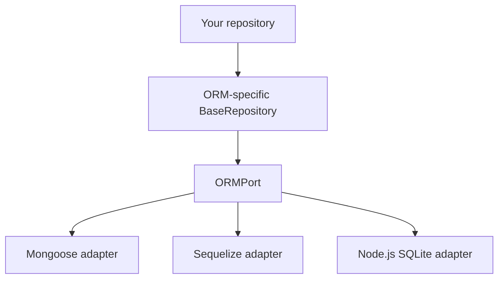

# ORM Support

Zacatl provides ORM-specific repository wrappers over a shared CRUD
implementation. Each repository targets one ORM; use separate repository
classes when an application uses multiple databases.



## Built-in ORMs

- Mongoose (MongoDB)
- Sequelize (PostgreSQL, MySQL, SQLite, and other Sequelize dialects)
- Node.js SQLite (`node:sqlite`, no external package required)

## Mongoose Example

```typescript
import { BaseRepository as MongooseRepository } from '@sentzunhat/zacatl/service/layers/infrastructure/repositories/mongoose/repository';
import { ORMType } from '@sentzunhat/zacatl/service/layers/infrastructure/orm/types';
import type { MongooseModel } from '@sentzunhat/zacatl/third-party/databases/mongoose';
import { Schema } from '@sentzunhat/zacatl/third-party/databases/mongoose';

const userSchema = new Schema<UserDb>({
  name: String,
  email: String,
});

class UserRepository extends MongooseRepository<UserDb, CreateUser, UserDTO> {
  constructor() {
    super({ type: ORMType.Mongoose, name: 'User', schema: userSchema });
  }

  async findByEmail(email: string): Promise<UserDTO | null> {
    const model = this.model as MongooseModel<UserDb>;
    return this.toLean(await model.findOne({ email }).lean());
  }
}
```

## Sequelize Example

```typescript
import { BaseRepository as SequelizeRepository } from '@sentzunhat/zacatl/service/layers/infrastructure/repositories/sequelize/repository';
import { ORMType } from '@sentzunhat/zacatl/service/layers/infrastructure/orm/types';
import { Model } from '@sentzunhat/zacatl/third-party/databases/sequelize';

class ProductModel extends Model {
  declare id: string;
  declare name: string;
}

class ProductRepository extends SequelizeRepository<ProductModel, CreateProduct, ProductDTO> {
  constructor() {
    super({ type: ORMType.Sequelize, name: 'Product' });
  }
}
```

## Node.js SQLite Example

```typescript
import { BaseRepository as NodeSqliteRepository } from '@sentzunhat/zacatl/service/layers/infrastructure/repositories/nodesqlite/repository';
import type { LeanDocument } from '@sentzunhat/zacatl/service/layers/infrastructure/repositories/types';

type UserDTO = LeanDocument<{ name: string; email: string }>;

class UserRepository extends NodeSqliteRepository<CreateUser, UserDTO> {
  constructor() {
    super({ name: 'users' });
  }
}
```

## Custom Adapter Contract

`ORMPort` is the adapter contract used by the shared repository implementation.
Import its type from the repository types subpath. Custom adapters also need a
model, readiness lifecycle, CRUD operations, and output normalization:

```typescript
import type { ORMPort, QueryOptions } from '@sentzunhat/zacatl/service/layers/infrastructure/repositories/types';

class MyAdapter<D, I extends object, O extends object>
  implements ORMPort<D, I, O>
{
  declare readonly model: D;

  async ready(): Promise<void> { throw new Error('Implement resource setup'); }
  async findById(id: string): Promise<O | null> { throw new Error('Implement lookup'); }
  async findMany(
    filter?: Record<string, unknown>,
    options?: QueryOptions,
  ): Promise<O[]> { throw new Error('Implement listing'); }
  async create(entity: I): Promise<O> { throw new Error('Implement creation'); }
  async update(id: string, update: Partial<I>): Promise<O | null> { throw new Error('Implement update'); }
  async delete(id: string): Promise<O | null> { throw new Error('Implement deletion'); }
  async exists(id: string): Promise<boolean> { throw new Error('Implement existence check'); }
  toLean(input: unknown): O | null { throw new Error('Implement output normalization'); }
}
```

The public `BaseRepository` implementation at
`service/layers/infrastructure/repositories/base-repository` accepts an
`ORMPort` adapter. Application repositories should normally extend the
ORM-specific wrappers shown above.
